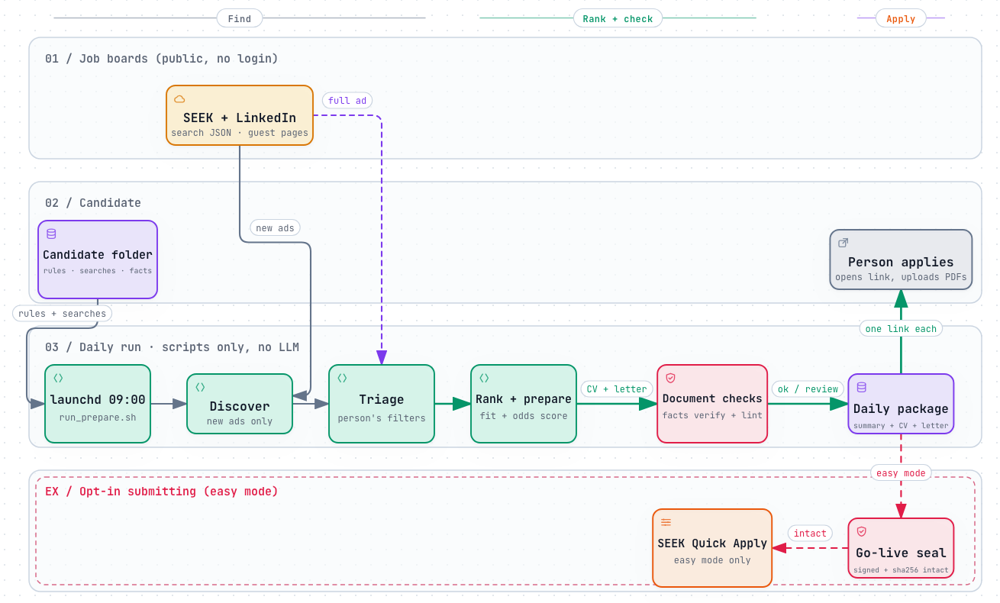

# job-harness

[](LICENSE)


A **Claude Code** harness for job searching in **Australia** (SEEK and LinkedIn). It takes a candidate from "here is my CV folder" to a ranked daily package of jobs, each with a CV and a cover letter that only use facts the person approved.

<p align="center">
  <a href="https://100founts.github.io/job-harness/daily-run.html">
    <picture>
      <source media="(prefers-color-scheme: dark)" srcset="docs/assets/daily-run-dark.png">
      
    </picture>
  </a>
  <br>
  <sub><a href="https://100founts.github.io/job-harness/daily-run.html">Open the interactive diagram</a> (every box links to the code it describes) · made with <a href="https://github.com/tt-a1i/archify">Archify</a> · source: <a href="docs/daily-run.archify.json"><code>docs/daily-run.archify.json</code></a></sub>
</p>

Every day at 9:00 it:
1. **discovers** new jobs from the person's saved searches (SEEK's search JSON and LinkedIn's public guest pages: no browser, no login, no LLM),
2. **filters** them by the person's rules (target titles, seniority, years asked, citizenship/clearance requirements, location),
3. **ranks** them by **fit** (the person's keywords found in the ad) plus **odds** (title level, years asked, fields they are not in, credentials or licences they lack, preferred places),
4. **prepares** up to 15: CV + cover letter (docx and PDF), each checked for invented figures and rule breaks,
5. writes a **daily package** (`~/job-packages/<slug>/<date>/`) with a summary per job: what it is, why it fits, odds, what to watch, how to apply ([see a sample](docs/sample-package.md)).

The person opens each link, clicks Apply and uploads the two PDFs. Nothing is submitted for them unless they choose a submitting mode (see *Modes*).

## Requirements
- macOS (the daily run uses launchd; the scripts themselves are portable)
- Python 3.10+ (standard library only)
- Node.js 18+ for documents: `cd templates/docs && npm install`
- [Claude Code](https://claude.com/claude-code) for onboarding and judgment steps
- Optional, for scripted SEEK Quick Apply: `cd apply && npm install && npx playwright install chromium`

## Quick start
```bash
git clone https://github.com/100FOUNTS/job-harness.git && cd job-harness
ln -s "$PWD/bin/job" ~/.local/bin/job     # optional: `job` on your PATH
job doctor && job test
claude                                    # open Claude Code here (the hooks only load inside this folder)
```
Inside Claude Code:
```
/job-onboard 0 ana     # new candidate, stages 0–5: intake → profile and gaps → tracks → master docs → profiles → alerts
/job-daily ana         # one daily cycle by hand
```
Then every day, unattended:
```bash
job schedule install ana --hour 9
job schedule run-now ana     # one run now, for testing
touch candidates/ana/STOP    # kill switch
```
`candidates/example/` is a **fictional** filled candidate (Sam Taylor, water resources engineer, Brisbane) to show what each file looks like.

## A candidate is a folder
Everything about a person lives in `candidates/<slug>/`; the code has nothing about any particular person.

| File | What it holds |
|---|---|
| `intake.json` | Contact, rules (e.g. never mention visa; never include practice exercises), preferences, sensitive answers used **only** when a form asks, `docs_language`, `ui_language` (`en`/`es`) |
| `targets.json` | Tracks (role families) with their CV, title keywords, searches, ranking keywords; global filters; the `ranking` block (fields they are not in, credentials/licences they lack, preferred places) |
| `facts.json` | Every figure a CV or letter may use, with its source. `job facts verify` rejects any other number |
| `answers.json` | Pre-approved answers to application questions |
| `docs/` | One CV JSON per track + a cover letter template → `job docs` builds docx + PDF |
| `state.json`, `tracker.json`, `approvals/` | Bookkeeping, changed only through `job` commands |

## Your own setup (stays out of git)
Candidate folders other than `example/`, the browser profile and `.claude/settings.local.json` are git-ignored, and `job test` fails if a personal candidate file is ever tracked. Owner preferences go in `.claude/settings.local.json` (read by Claude Code) and in the shell that runs `job schedule install` (copied into the launchd job):
```json
{ "env": { "JOB_PACKAGE_DIR": "/Users/you/Applications-packages", "JOB_HUMAN_SIGN": "go-live" } }
```
`JOB_PACKAGE_DIR` moves the daily packages; `JOB_HUMAN_SIGN=""` lets the agent sign every approval after your explicit OK in the chat (default: go-live needs your own signature). The package language is per candidate (`intake.ui_language`).

## Modes
| Mode | What happens | Submits? |
|---|---|---|
| `prepare` (default for the daily run) | Scripts discover, filter, rank and build the package | No: the person applies |
| `easy` | `prepare` + scripted SEEK Quick Apply (Playwright, dedicated browser profile; the person logs in once) | Yes, SEEK Quick Apply only |
| `dry-run` / `live` | Agent-driven cycle with Claude in Chrome (`/job-daily`) | Only in `live` |

Submitting modes need a signed, intact **go-live** approval. Approvals are sealed with the sha256 of the files they cover: editing `intake.json`, `targets.json`, `answers.json`, `facts.json` or the master documents breaks the seal and stops submissions until the person signs again. By default only the person can sign go-live, in their own terminal (`job sign <slug> <id>`).

## Safety by construction
| Piece | What it guarantees |
|---|---|
| `facts.json` + `job facts verify` | No invented figures in any CV or letter |
| `intake.rules` + `job lint` | The person's rules, ATS-safe format (no ligature fonts), CV length, one-page letter |
| `answers.json` + `job answer` | Known questions get approved answers; sensitive ones are never improvised; new ones are logged for review |
| `job gate` / `job sign` | Sealed approvals for master documents, profile changes, targets and go-live |
| `tracker.json` + quotas | No duplicates; per platform/day/week limits enforced in code |
| `hooks/gate.py` | Blocks the agent from: signing as a human, hand-editing bookkeeping, reading secrets, deleting data or account items, clicking submit unless live |
| `learn/observations.jsonl` | Lessons from real failures (SEEK/LinkedIn quirks, PDF fonts, ATS parsing) |

## Layout
```
bin/job                      single entry point (`job help`)
.claude/skills/              job-onboard (stages 0–5 + references) · job-daily · job-learn
.claude/agents/              job-triager · tailor-writer · form-filler · profile-auditor
hooks/gate.py                PreToolUse safety rules
scripts/                     discover, triage, prepare (ranking + package), apply, answer, docs, lint, facts,
                             tracker, report, state, gates, cleanup, schedule, run_prepare.sh, run_daily.sh
templates/candidate/         blank candidate files
templates/docs/              docx (Arial) and PDF (pdfkit, Helvetica) generators
apply/                       SEEK Quick Apply (Playwright)
candidates/example/          fictional example candidate
docs/                        architecture diagram (interactive HTML + Archify source) and a sample package
```

## Honest limits
- **Australia only** as built: SEEK AU, LinkedIn with Australian locations, Australian work-rights questions. Another country needs its own discovery and question rules.
- **Platform terms.** Scripted applying is against LinkedIn's terms and likely SEEK's, and can get the person's account restricted. LinkedIn Easy Apply is deliberately not automated. The default daily run only reads public search results and prepares documents.
- LinkedIn's guest pages rate-limit (HTTP 429) after many requests; one discovery run per day is fine, and a job whose description could not be read is retried the next day instead of being ranked blind.
- SEEK sometimes shortens an ad and drops its eligibility paragraph; when the LinkedIn twin of an ad asks for citizenship or PR, both copies are dropped. Still read every ad before applying.
- The ranking is deterministic keyword and rule scoring, not a prediction. It orders the list; the person decides.
- The hook is pattern-based: it stops mistakes, not deliberate obfuscation.
- External ATS (Workday, PageUp…) usually need an account → always left to the person.

## License
MIT
