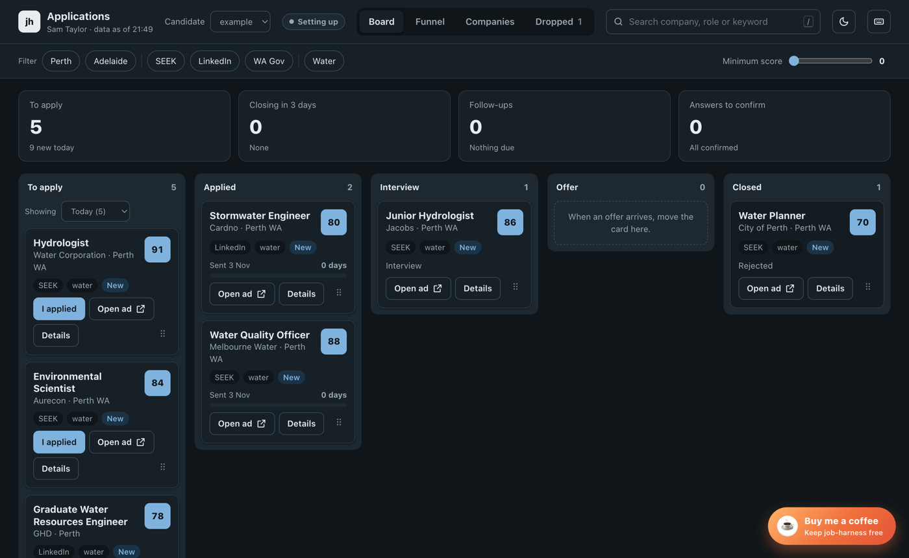
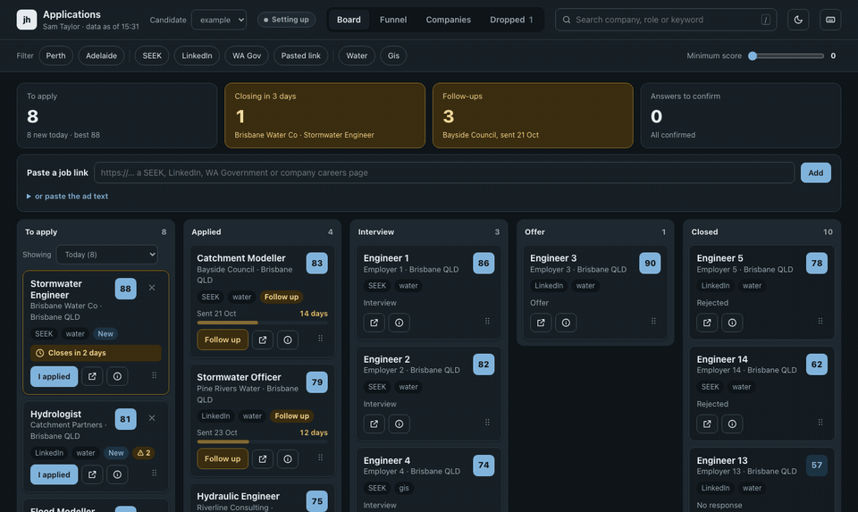
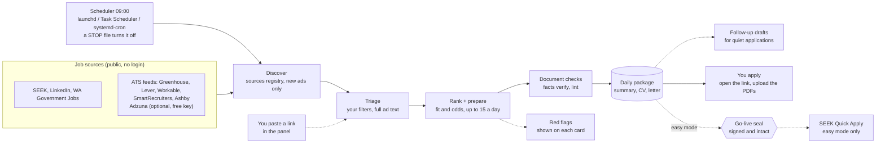

# job-harness

[](LICENSE)


[](https://donate.stripe.com/4gM28t7b1g0kgHd5YE4wM00)

A **Claude Code** harness for job seekers in **Australia**. You give it a folder with your CV and certificates. It helps you build an honest profile and every day it finds new jobs on SEEK, LinkedIn and WA Government Jobs, ranks them, and prepares a CV and cover letter for the best ones. You open the folder (or a local board), click Apply on the ad and upload the files.

New to the terminal? Start with **[docs/GETTING-STARTED.md](docs/GETTING-STARTED.md)**. Prefer Spanish? **[docs/es/README.md](docs/es/README.md)**. Just want the writing help in a normal chat, without installing anything? Use the **[lite pack](lite/README.md)** for Cowork and claude.ai. A short overview page is at **[100founts.github.io/job-harness](https://100founts.github.io/job-harness/)**.

<p align="center"><br><sub>The local panel (<code>job panel</code>), with sample data for the fictional candidate.</sub></p>

<p align="center"><br><sub>20 seconds in the panel: details and full ad, drop with Undo, what leads to interviews, and what you dropped. Sample data.</sub></p>

### The daily run

<sub>Source of the interactive version (every box links to the code it describes): <a href="docs/daily-run.archify.json"><code>docs/daily-run.archify.json</code></a>, made with <a href="https://github.com/tt-a1i/archify">Archify</a>. Dotted lines are optional. The only step that can submit is the last one, and it needs your signed go-live.</sub>

## What it does
Every day (at the hour you choose) it:
1. **discovers** new jobs from your saved searches (SEEK's search JSON, LinkedIn's public guest pages, WA Government Jobs: no browser, no login, no AI),
2. **filters** them by your rules (target titles, seniority, years asked, citizenship or clearance requirements, location). Titles match with small variations ("web developer" also finds "Web/UI Developer"), and when a title is too generic it reads the ad and keeps it if it names your core skills,
3. **ranks** them by **fit** (your keywords found in the ad) plus **odds** (title level, years asked, fields you are not in, credentials or licences you lack, preferred places). A whole track, or some titles, can be moved down or up,
4. **prepares** up to 15: a CV and cover letter (docx and PDF), each checked for invented figures and rule breaks,
5. writes a **daily package** (`~/job-packages/<slug>/<date>/`) with a summary per job: what it is, why it fits, odds, what to watch, how to apply ([see a sample](docs/sample-package.md)).

Also:
- **More sources, no scraping.** Follow single employers through their public job feeds on Greenhouse, Lever, Ashby, Workable or SmartRecruiters (`{"platform": "lever", "company": "acme", "location": "Perth"}` in `targets.json`), and add Adzuna with a free key (`JOB_ADZUNA_APP_ID` / `JOB_ADZUNA_APP_KEY`). `job doctor` lists the sources. A new portal or country is one small module: [docs/ADDING-A-SOURCE.md](docs/ADDING-A-SOURCE.md).
- **Paste a link.** Found an ad yourself? Paste its link (or its text, when a page can't be read) in the panel, or run `job addlink <slug> <url>`. It is scored, gets a CV and cover letter and lands in *To apply*; if your rules would have dropped it, you are told why.
- **Red flags.** Each prepared ad is checked for pay below your minimum or the legal minimum wage, unpaid trials, commission-only work, upfront fees and other scam patterns, a hidden employer and constant reposts (`job flags`). They are warnings only: nothing is dropped or re-ranked.
- **Follow-ups.** Applications with no news for 10 days get a short, polite follow-up draft in their folder (`job followup`). It is never sent for you.
- **What leads to interviews.** After 10 applications with an answer, the panel's *Funnel* shows interview rates by score band, track and source, with one plain suggestion when something stands out. Your targets never change by themselves.
- **On your phone.** `job panel --lan` serves the board on your wifi and prints a link with a one-time token. Anyone on that wifi with the link can see your board, and the local network is not encrypted, so use it at home and don't share the link.

Ads it dropped stay visible in the panel, with the reason; the best near misses of the week are listed under *Maybe worth a look*, and rescuing one teaches the filter a new title. You open each link, click Apply and upload the two PDFs. Nothing is sent for you unless you choose a submitting mode and sign it yourself (see *Modes*).

## What it never does
- Claude does not solve captchas, create accounts or type passwords. That is a limit of Claude itself, not a setting of this harness, so a job that needs one of those steps is marked `manual-review` for you to finish.
- It never submits an application without your own signature on a **go-live** approval.
- It never invents experience, dates or figures: every number in a CV or letter must come from your own `facts.json`.
- It never uses a paid service or API (no Apify, no paid credits).
- Your files stay in a folder on your computer; the harness has no server of its own. What Claude reads during a session (your CV, the ads) is processed by Claude under your own Claude plan.

## Before you start
| | What | Needed for |
|---|---|---|
| **Required** | A computer with macOS, Windows or Linux | everything |
| **Required** | A paid Claude subscription (Pro, Max, Ultra, Team or Enterprise) with Claude Code: the Claude desktop app (Code tab) or the CLI | onboarding, tailoring, judgment steps |
| **Required** | Python 3.9 or newer | the scripts |
| **Required** | Node.js 20 or newer | building CVs and letters, reading PDFs |
| **Required** | A folder with your CVs, certificates and other documents | stage 0 (intake) |
| Optional | The **Claude in Chrome** extension (connect with `/chrome` in Claude Code) | only the profile and alerts stages and LinkedIn extraction |
| Optional | Playwright, installed with `job setup --apply-tools` | only scripted SEEK Quick Apply (modes `easy`/`full`) |
| Not needed | Gmail connector, any paid API (an Adzuna key is free and optional) | - |

`job doctor` checks all of this and prints the exact command to fix what is missing.

> **Windows and Linux support is new.** The test suite runs on macOS, Windows and Linux in CI, but the harness has not yet been used day to day on a real Windows or Linux PC. If something breaks, see [docs/TROUBLESHOOTING.md](docs/TROUBLESHOOTING.md) and open an issue.

## Install
### A. Claude desktop app (no terminal)
1. Install the desktop app ([download links](https://code.claude.com/docs/en/desktop-quickstart)), sign in and open the **Code** tab. The app includes Claude Code.
2. Add the marketplace and install the plugin: type `/plugin marketplace add 100FOUNTS/job-harness`, then `/plugin install job-harness@100founts`, or use **+ → Add plugins**. If the app does not accept those commands, run them once in a terminal as in B: the terminal and the desktop app share the same plugins.
3. Type `/job-harness:job-start`. Step by step: [docs/GETTING-STARTED.md](docs/GETTING-STARTED.md).

### B. Claude Code in a terminal, as a plugin
```bash
claude plugin marketplace add 100FOUNTS/job-harness
claude plugin install job-harness@100founts
claude                      # then type: /job-harness:job-start
```
Tested with Claude Code 2.1.317 on macOS.
Installed as a plugin, the skills are namespaced: `/job-harness:job-start`, `/job-harness:job-onboard`, `/job-harness:job-daily`, `/job-harness:job-tailor`, `/job-harness:job-interview`, `/job-harness:job-learn`. The plugin's `bin/` folder is on the PATH of Claude's shell, so `job ...` works there. Your data lives outside the plugin, in `~/job-harness-data` (or `JOB_DATA_DIR`), so updates never touch it. Open Claude Code **in that folder** each time: the safety hooks only run there.

### C. Clone (developers and current users)
```bash
git clone https://github.com/100FOUNTS/job-harness.git
cd job-harness
bin/job setup               # Windows: bin\job.cmd setup
claude                      # open Claude Code in this folder (the hooks only load inside it)
```
`job setup` checks Python and Node.js, installs the document tools, puts `job` on your PATH (a link in `~/.local/bin` on macOS and Linux; on Windows it tells you how to add `bin\` to PATH) and creates the package folder. Safe to run again. In a clone the skills have short names: `/job-start`, `/job-onboard`, and so on.

## First steps
1. **Start.** `/job-start` (plugin: `/job-harness:job-start`). Claude checks your machine, explains what happens and asks your first name and where your documents are.
2. **Onboard**, one stage at a time (`job status <name>` always shows the next step):

   | Stage | What happens |
   |---|---|
   | 0 Intake | Claude reads your documents and extracts facts with their source |
   | 1 Profile and gaps | Your rules, preferences and the figures you can explain in an interview |
   | 2 Target tracks | The role families you apply to, with titles, keywords and searches |
   | 3 Master documents | One CV per track and a cover letter template, built and checked |
   | 4 Platform profiles | Audit of your SEEK and LinkedIn profiles, then approved fixes (needs Claude in Chrome) |
   | 5 Alerts | Saved searches on each platform (needs Claude in Chrome) |
3. **Schedule the daily run.** `job schedule install <name> --hour 9` works on macOS (LaunchAgent), Windows (Task Scheduler) and Linux (systemd user timer; if systemd is missing it prints a crontab line). `job schedule run-now <name>` runs once now to test; `job schedule status <name>` shows whether it is installed. The no-config alternative is a **scheduled task in the Claude desktop app**; it only runs while the app is open and the computer is awake.
4. **See the results.** Run `job panel`: a local board (it opens in your browser at `http://127.0.0.1:8765`, reachable only from your computer) with every application, why each ad fits or was dropped, and buttons to mark what you applied to and what happened next. The same files are in the package folder, `~/job-packages/<name>/<date>/` (`SUMMARY.md`, `index.html` and one folder per job with the PDFs). Change the folder with `JOB_PACKAGE_DIR`.

## Approvals in plain words
An **approval** is a record that you checked something. It is sealed with the fingerprint (sha256) of the files it covers: if a file changes later, the seal breaks and the approval stops counting.

| Approval | Covers | Who signs |
|---|---|---|
| `targets` | your target tracks and searches | Claude, after you say OK in the chat |
| `master-docs` | your master CV and cover letter | Claude, after you say OK in the chat |
| `profile-changes` | edits to your SEEK/LinkedIn profiles | Claude, after you say OK in the chat |
| `report` | the daily report | Claude, after you say OK in the chat |
| `go-live` | letting the harness **submit** applications | **only you** (unless the owner turns this off) |

Claude signs only after an explicit OK from you for that specific approval, and records your words in the note. You never need to type a command for these. `go-live` is only needed for the optional submitting modes; the default flow (you apply yourself) never needs it. To sign it without a separate terminal, type this inside Claude Code (the `!` runs it as you, not as Claude): `! job sign <name> <id> --confirm <name>`. In a normal terminal: `job sign <name> <id>` and type your name when asked. `job review <name> <id>` shows what you are about to sign. The owner can let Claude sign `go-live` too with `JOB_HUMAN_SIGN=""` (not recommended).

## Modes
| Mode | What happens | Submits? |
|---|---|---|
| `prepare` | The daily scripts discover, filter, rank and build the package | No: you apply |
| `easy` | `prepare` + scripted SEEK Quick Apply (Playwright, a dedicated browser profile; you log in once) | Yes, SEEK Quick Apply only, with a valid go-live |
| `full` | `easy` + simple company-site forms without account creation (an agent in Chrome) | Yes, with a valid go-live |
| `dry-run` | Agent-driven cycle with Claude in Chrome (`/job-daily`): fills forms, stops before the last click | No |
| `live` | The same agent-driven cycle, clicking submit | Yes, with a valid go-live |

New candidates start in `dry-run`; the daily schedule then behaves like `prepare` (it only submits in `easy` or `full`). Change it with `job state <name> mode <mode>`. Per platform, per day and per week limits are enforced in code (`job track <name> quota`).

## Safety
| Piece | What it guarantees |
|---|---|
| `facts.json` + `job facts verify` | No invented figures in any CV or letter |
| `intake.rules` + `job lint` | Your rules, an ATS-safe format (no ligature fonts), CV length, a one-page letter |
| `answers.json` + `job answer` | Known questions get approved answers; sensitive ones are never improvised; new ones are logged for review |
| `job gate` / `job sign` | Sealed approvals, as above |
| `tracker.json` + quotas | No duplicates; limits per platform, day and week |
| `hooks/gate.py` | **Blocks** Claude from: signing as a human, hand-editing bookkeeping files, reading secrets or browser profiles, deleting your data or account items, and clicking submit unless a candidate is in `live` with a valid go-live. **Asks you first** before changing the harness's own rules (`hooks/`, `bin/`, `scripts/gates.py`, `.claude/settings*.json`), so a job ad aimed at an AI cannot rewrite them quietly |
| Ads are data | Hidden text is stripped from every ad and ads with text aimed at an AI are flagged; Claude never follows what an ad says |
| `learn/observations.jsonl` | Lessons from real failures (SEEK/LinkedIn quirks, PDF fonts, ATS parsing) |

The hook is pattern-based: it stops mistakes and casual workarounds, not deliberate obfuscation. It only runs in the harness folder (clone) or your data folder (plugin).

## Costs
- **The daily run costs nothing**: discover, triage, prepare and the report are plain scripts. No AI, no paid API, no browser.
- Onboarding, `/job-tailor` (writer + reviewer for the top jobs) and `/job-interview` use **your Claude plan**, like any Claude Code session.
- The agent-driven daily cycle (`job schedule install <name> --runner agent`, modes `dry-run`/`live`) also uses your Claude plan every run. The default does not.
- Nothing in the harness uses a paid service.

## Layout
```
bin/job, bin/job.cmd         single entry point (`job help`); .cmd is for Windows
.claude-plugin/              plugin and marketplace manifests
.claude/skills/              the six skills below
.claude/agents/              the five agents below
hooks/                       gate.py (PreToolUse safety rules) and py.sh (finds Python)
scripts/                     discover, triage, prepare, apply, answer, docs, lint, facts, tracker, report, state,
                             gates, cleanup, schedule, panel, setup, doctor, run_prepare, run_daily, ...
templates/candidate/         blank candidate files
templates/docs/              docx (Arial) and PDF (pdfkit, Helvetica) generators, PDF reader
apply/                       SEEK Quick Apply (Playwright)
candidates/example/          a fictional filled candidate ("Sam Taylor") to show what each file looks like
docs/                        guides, architecture diagram, sample package and the landing page
lite/                        standalone skills for Cowork and claude.ai (no install)
```

| Skill | Purpose |
|---|---|
| `job-start` | First run: checks the machine, explains the harness, creates the candidate. Also carries the working rules in a plugin install |
| `job-onboard` | Onboarding stages 0 to 5 |
| `job-daily` | The agent-driven daily cycle (modes `dry-run`/`live`) |
| `job-tailor` | A writer and a separate reviewer tailor the CV and letter of the day's top jobs |
| `job-interview` | Interview prep pack for one application, and a mock interview |
| `job-learn` | Reviews recorded lessons and proposes improvements |

| Agent | Purpose |
|---|---|
| `job-triager` | Judges a shortlist against the real profile (no browser) |
| `tailor-writer` | Writes a tailored CV and letter for one job, truthfully |
| `tailor-reviewer` | Reviews it as a hiring manager would, in a fresh context |
| `form-filler` | Fills one application form in your Chrome (stops before submitting in `dry-run`) |
| `profile-auditor` | Read-only audit of your SEEK and LinkedIn profiles |

## A candidate is a folder
Everything about a person lives in `candidates/<slug>/` (in a plugin install, inside your data folder); the code has nothing about any particular person.

| File | What it holds |
|---|---|
| `intake.json` | Contact, rules (e.g. never mention visa; never include practice exercises), preferences, sensitive answers used **only** when a form asks, `docs_language`, `ui_language` (`en`/`es`) |
| `targets.json` | Tracks (role families) with their CV, title keywords, searches, ranking keywords; global filters; the `ranking` block |
| `facts.json` | Every figure a CV or letter may use, with its source. `job facts verify` rejects any other number |
| `answers.json` | Pre-approved answers to application questions |
| `docs/` | One CV JSON per track + a cover letter template; `job docs` builds docx + PDF |
| `state.json`, `tracker.json`, `approvals/` | Bookkeeping, changed only through `job` commands |
| `jobs.db` | Every ad ever listed (SQLite): verdict and reason, full description, fit, outcome. `job db <slug> stats` |
| `logs/` | One log file per day for the daily run |

## Your own setup (stays out of git)
Candidate folders other than `example/` and `.claude/settings.local.json` are git-ignored. Owner preferences go in `.claude/settings.local.json` (a clone) or `<data folder>/settings.json` (a plugin install), and in the shell that runs `job schedule install` (copied into the schedule):
```json
{ "env": { "JOB_PACKAGE_DIR": "/Users/you/Applications-packages", "JOB_HUMAN_SIGN": "go-live" } }
```
`JOB_PACKAGE_DIR` moves the daily packages. `JOB_HUMAN_SIGN=""` lets Claude sign every approval after your explicit OK (the default: `go-live` needs your own signature). The panel shows a small "Buy me a coffee" button that supports 100 FOUNTS, who build job-harness; `JOB_SUPPORT_URL` points it elsewhere, and `JOB_SUPPORT_URL=""` hides it.

## Honest limits
- **Australia only** as built: SEEK AU, LinkedIn with Australian locations, WA Government Jobs, Australian work-rights questions. Another country needs its own discovery and question rules.
- **Sites change.** SEEK, LinkedIn and WA Government Jobs can change their pages or block requests; when that happens a search returns nothing until the harness is updated.
- **Platform terms.** Scripted applying is against LinkedIn's terms and likely SEEK's, and can get your account restricted. LinkedIn Easy Apply is deliberately not scripted. The default daily run only reads public search results and prepares documents.
- LinkedIn's guest pages rate-limit (HTTP 429) after many requests; one discovery run per day is fine, and a job whose description could not be read is retried the next day instead of being ranked blind.
- SEEK sometimes shortens an ad and drops its eligibility paragraph; when the LinkedIn twin of an ad asks for citizenship or PR, both copies are dropped. Still read every ad before applying.
- The ranking is deterministic keyword and rule scoring, not a prediction. It orders the list; you decide.
- External application systems (Workday, PageUp, ...) usually need an account, so they are always left to you.
- Windows and Linux are new (see above). The local schedule only runs while the computer is on or awake (macOS and systemd run a missed job when the computer wakes up).

## Lite version (Cowork and claude.ai)
No Claude Code, no terminal? [`lite/`](lite/README.md) has three standalone skills you upload to claude.ai or Cowork: review an ad against your CV, tailor a CV and cover letter, and prepare for an interview. They have none of the daily search, panel or checks; see [lite/README.md](lite/README.md) for what you get and how to upload them.

## Contributing
Bug reports, broken-site reports, new sources and new countries are welcome. Start with [CONTRIBUTING.md](CONTRIBUTING.md) and the [Code of Conduct](CODE_OF_CONDUCT.md). Security problems: [SECURITY.md](SECURITY.md). Changes by version: [CHANGELOG.md](CHANGELOG.md); how releases are cut: [docs/RELEASING.md](docs/RELEASING.md).

## More help
- [docs/GETTING-STARTED.md](docs/GETTING-STARTED.md): step by step, no terminal needed
- [docs/GLOSSARY.md](docs/GLOSSARY.md): the words used here
- [docs/TROUBLESHOOTING.md](docs/TROUBLESHOOTING.md): when something does not work
- [docs/es/README.md](docs/es/README.md): guía rápida en español
- [docs/sample-package.md](docs/sample-package.md): what a daily package looks like
- [CHANGELOG.md](CHANGELOG.md): what changed in each version
- [Landing page](https://100founts.github.io/job-harness/): a one-page overview (GitHub Pages, source in [docs/index.html](docs/index.html))

## Support
job-harness is free, open source and uses no paid services. If it helped your job search, a coffee keeps it going.

<p align="center"><a href="https://donate.stripe.com/4gM28t7b1g0kgHd5YE4wM00"></a><br><a href="https://donate.stripe.com/4gM28t7b1g0kgHd5YE4wM00"><b>☕ Buy me a coffee</b></a><br>Prefer a monthly sponsorship? <a href="https://github.com/sponsors/100FOUNTS">Sponsor 100FOUNTS on GitHub</a>.</p>

## License
MIT
